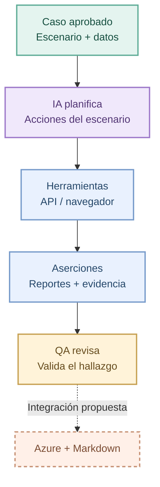
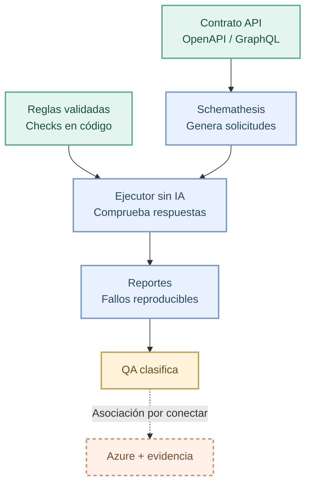
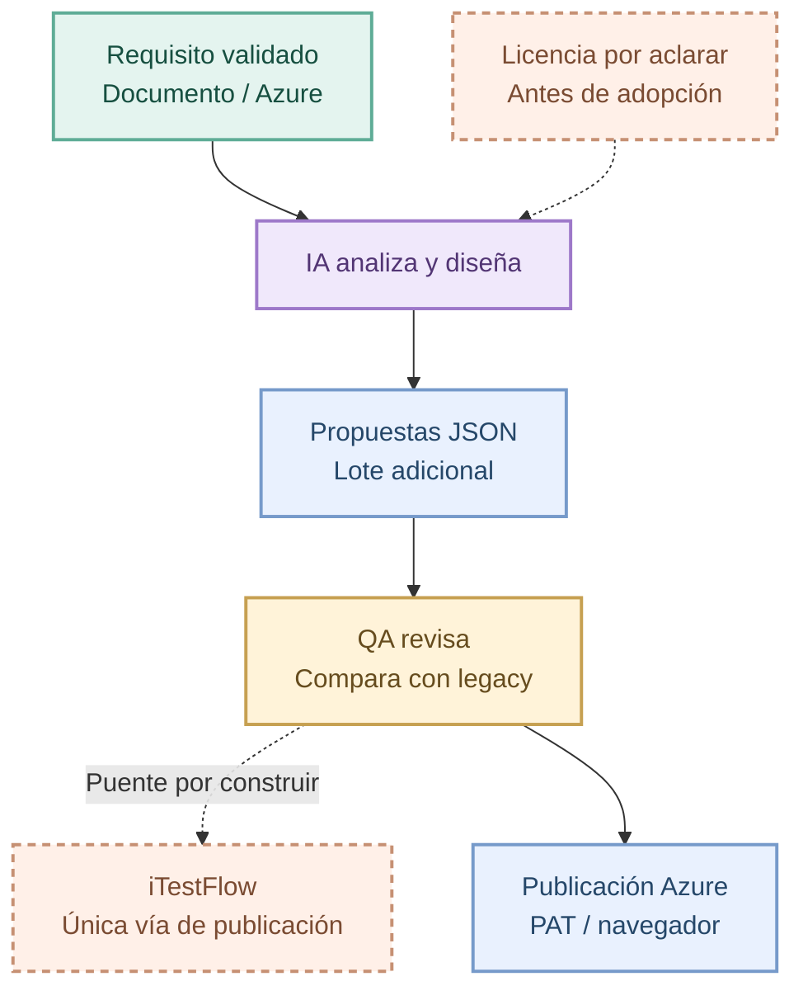
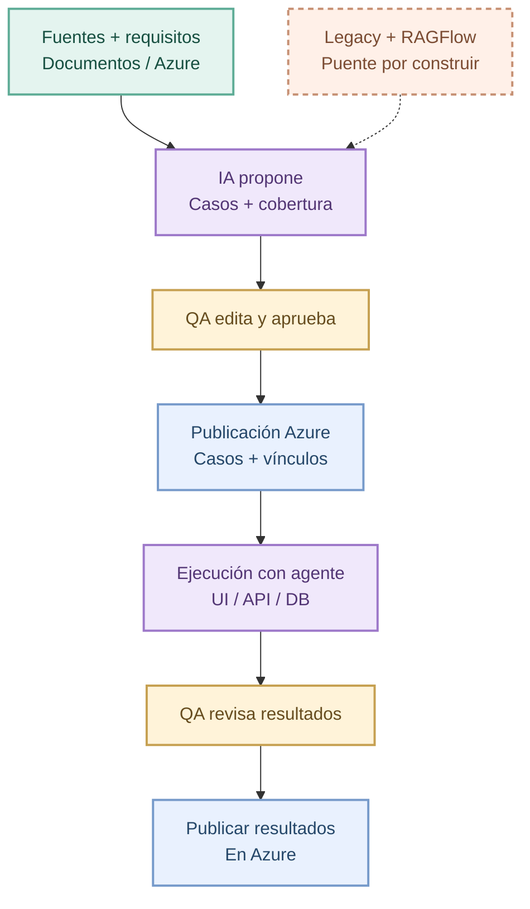
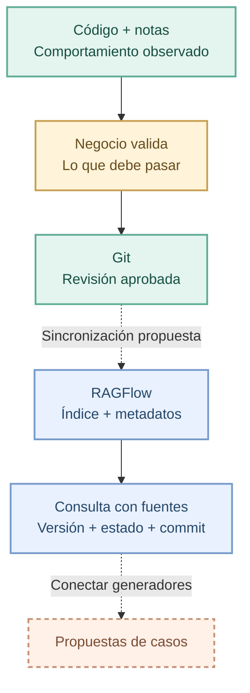
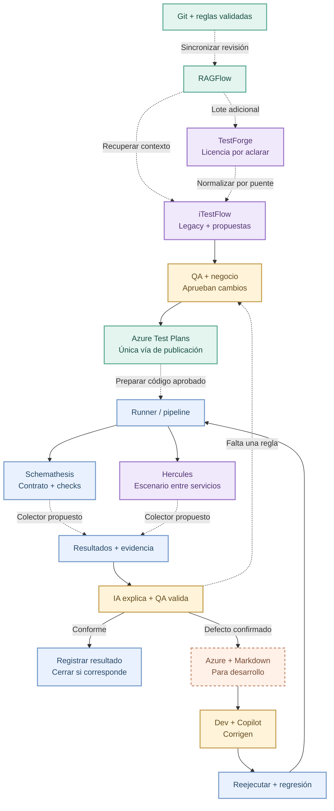

# Diagramas editables del reporte de soluciones QA

Actualización: 5 de octubre de 2026. Fuente del [reporte HTML](Reporte-soluciones-QA.html). El HTML incluye SVG renderizados: no necesita Mermaid ni conexión al abrir. Para editar, cambiar estos bloques y regenerar las figuras.

Las herramientas se revisaron por código y documentación; no se instalaron sus stacks. Los controles humanos y conexiones con la compañía forman parte del diseño propuesto. Las líneas punteadas marcan puentes por construir. El diagrama conjunto es una propuesta completa, no una instalación existente.

## 1. Hercules

El ejecutor usa IA durante el escenario. Los reportes son una salida documentada; su revisión y asociación con Azure se integran en el proceso propuesto.

## 2. Schemathesis

El contrato permite generar variaciones y secuencias; la regla funcional específica necesita un check codificado. El runner base no usa LLM.

## 3. TestForge

Genera propuestas de casos; no se verificó un runner de pruebas de la aplicación. En el circuito conjunto se usa un puente propuesto, sin habilitar un segundo publicador.

La publicación propia de TestForge está documentada, pero es una alternativa al circuito con iTestFlow; no se habilitan ambos para los mismos casos. El código ejecutable y la ejecución de la aplicación se preparan aparte.

## 4. iTestFlow

Incluye revisión/publicación y código de ejecución UI/API/DB. Reconciliar IDs legacy, consultar RAGFlow y recibir resultados externos requiere diseño y verificación.

Crear casos no ejecuta automáticamente el código. La flecha hacia ejecución indica el recorrido que debe configurarse y probarse; no un disparo automático confirmado.

## 5. Git, RAGFlow y versiones

Git conserva revisiones; RAGFlow es el índice consultable existente. La sincronización, metadatos y filtros de la versión instalada siguen por verificar.

## 6. Las cuatro soluciones orquestadas

Diseño por construir. TestForge agrega un lote pequeño distinto, condicionado a aclarar licencia; iTestFlow concentra revisión y publicación. El piloto puede usar menos piezas. Mantener IDs requiere reconciliación explícita, no regeneración indiscriminada.

Un problema de test, entorno, datos o intermitencia se investiga y se reejecuta tras resolver su causa; no se entrega como defecto de producto confirmado. La clasificación conserva las hipótesis y evidencia anterior.
