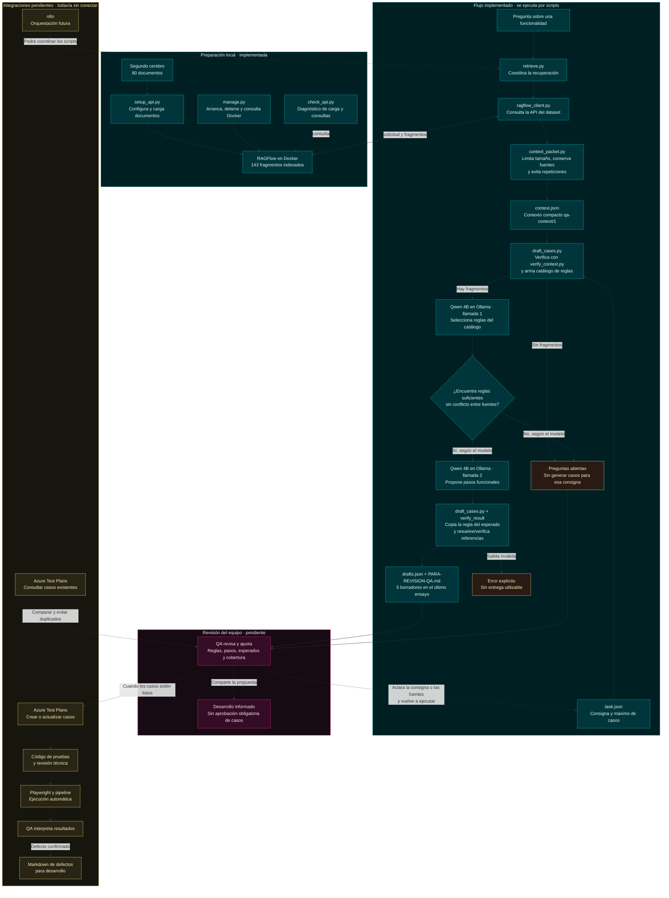

# Proceso actual de QA agentizada

Estado documentado al 2 de noviembre de 2026. Turquesa: implementado y probado en el piloto. Rosa: revisión humana pendiente. Amarillo y flechas punteadas: conexiones futuras o tareas de apoyo.

El Markdown que ya generamos contiene **borradores de casos para QA**. El Markdown de defectos confirmados es una entrega futura distinta. Las verificaciones de los scripts comprueban integridad y formato; no garantizan corrección semántica ni cobertura. La última suite registrada pasó 57 tests.

Scripts de apoyo que ya existen:

- Recuperación y calibración: `ragflow-local/evaluate_retrieval.py`, `calibrate_retrieval.py`, `evaluate_adapter.py`.
- Comparación de modelos y ensayo integrado: `ollama-pilot/evaluate_small_models.py`, `evaluate_grounded_drafts.py`.
- Referencia local: `scripts/brain.py` y `document_utils.py` consultan archivos locales; se conservaron como ruta medida de comparación y no se usan como sustituto directo del contexto remoto en este diagrama.
- Métricas y reportes: `scripts/collect_metrics.py`, `extract_usage.py`, `extract_transcript.py`, `build_report.py`, `build_explanation.py` y `ragflow-local/build_test_report.py`.
