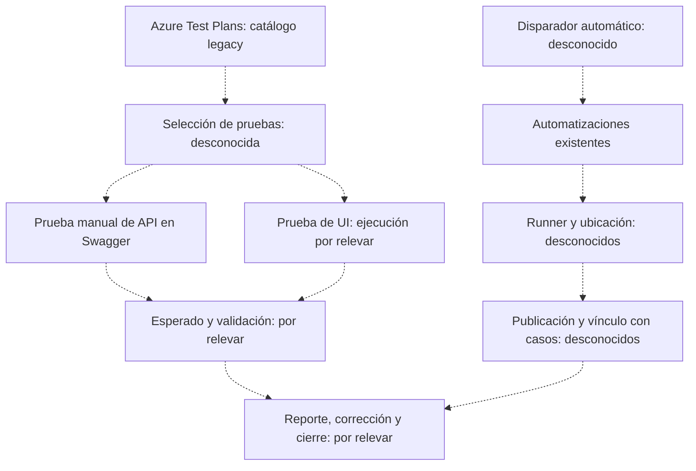
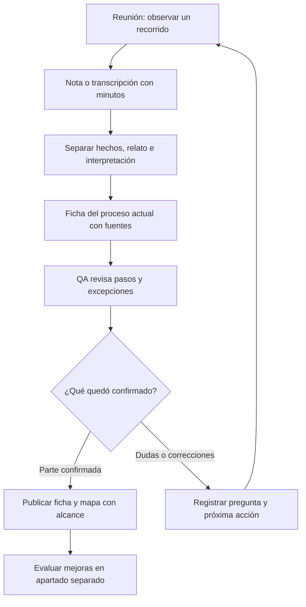
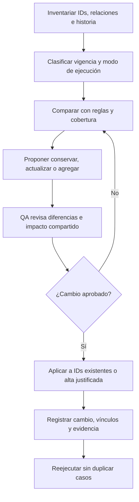
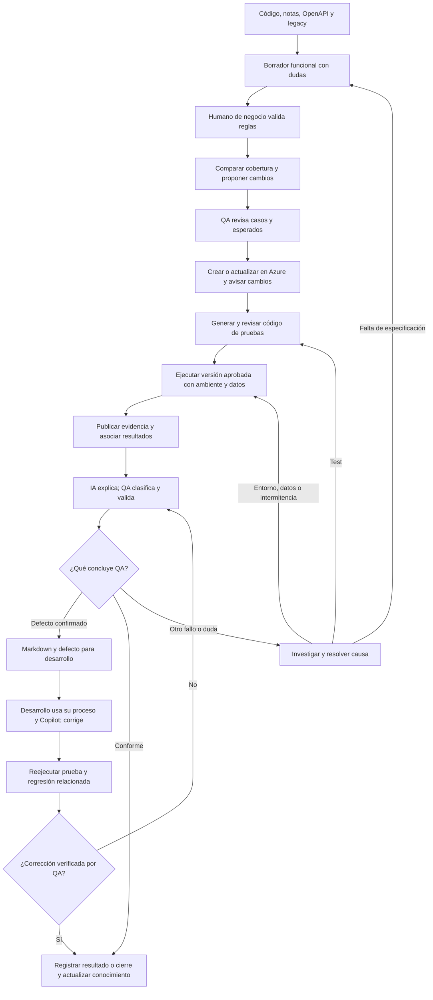

# Aprender el proceso de QA y preparar una mejora gradual

**Documento vivo · 5 de octubre de 2026 · Etapa: relevamiento.**

El primer paso es observar con QA un caso manual y una ejecución automática de principio a fin. Tu trabajo inicial como trainee es entender qué hacen, por qué lo hacen y dónde queda el resultado. Después podremos diseñar agentes sobre ese proceso real. No hace falta elegir ahora n8n, IBM ni un MCP.

## Índice

- [Qué sabemos](#qué-sabemos)
- [Vocabulario para empezar](#vocabulario-para-empezar)
- [Primeros pasos](#primeros-pasos)
- [Tu primera semana](#tu-primera-semana)
- [Mapa actual parcial](#mapa-actual-parcial)
- [De reunión a proceso validado](#de-reunión-a-proceso-validado)
- [Tratamiento de casos legacy](#tratamiento-de-casos-legacy)
- [Circuito objetivo propuesto](#circuito-objetivo-propuesto)
- [Qué comprobar en el piloto](#qué-comprobar-en-el-piloto)
- [Informe para desarrollo](#informe-para-desarrollo)
- [Cómo mantener esta guía](#cómo-mantener-esta-guía)

## Qué sabemos

**Confirmado por relato del usuario; todavía no observado con QA:**

- La compañía usa Azure Test Plans y tiene muchos casos legacy, es decir, casos heredados de trabajos anteriores.
- Existen automatizaciones que se ejecutan automáticamente. Aún no sabemos dónde, con qué herramientas ni cómo se registran sus resultados.
- Hay pruebas manuales de APIs desde Swagger y aplicaciones con interfaz de usuario.
- El equipo tiene GitHub Copilot y recibió un workbook preparado por el usuario para operar un MCP de Playwright y hacer pruebas. Su contenido y las herramientas exactas no fueron inspeccionados.
- El usuario usa Obsidian y Zettelkasten: descarga código y genera con Copilot y su prompt notas de conocimiento que hoy usa para generar casos. No se inspeccionaron esas notas.

**Requisitos expresados por el usuario:** conservar Azure Test Plans, integrar el legacy sin reemplazarlo ni duplicarlo indiscriminadamente, aprender en reuniones y registrar el proceso en texto plano. QA debe mantener juicio de negocio, exploración y evaluación de cobertura.

**PROPUESTA para evaluar:** producir documentación funcional desde código y notas, validarla con alguien que conozca negocio, comparar con los casos existentes y generar propuestas de casos y pruebas. Copilot puede ser la interfaz inicial para conversar sobre cambios y resultados. Código y notas muestran comportamiento técnico; no confirman por sí solos lo que el negocio necesita.

**Preguntas abiertas:** selección de pruebas, resultados esperados, repositorios, frameworks, runner, disparadores, ambientes, datos, publicación, asociaciones, revisión y cierre. Están en el [registro](Registro-QA.md). Azure DevOps MCP es un candidato; también puede usarse API u otra vía. n8n y alguna plataforma IBM watson son opciones futuras; el producto IBM exacto sigue sin definir.

## Vocabulario para empezar

| Término | Significado práctico |
| --- | --- |
| Plan | Organiza un alcance de pruebas, por ejemplo una entrega. |
| Suite | Agrupa casos dentro de un plan. |
| Caso | Describe precondiciones, datos, pasos y qué debería pasar. Registrar un caso no produce automáticamente código ejecutable. |
| Automatización / framework | Código que realiza acciones y verifica resultados / herramientas usadas para escribirlo. |
| Runner | Programa que ejecuta ese código. Hay que identificar el que usa el equipo. |
| Pipeline | Secuencia configurada de tareas; puede ejecutar el runner y publicar resultados. Aún no sabemos si ni cómo la usan aquí. |
| Run o corrida / resultado | Ejecución identificable / lo ocurrido para una prueba en esa ejecución. |
| Aserción | Comprobación explícita, por ejemplo que la respuesta tenga el estado esperado. |
| API / OpenAPI / Swagger | Operaciones para intercambiar datos / contrato técnico de la API / interfaz que el equipo usa para invocarla manualmente. |
| MCP | Protocolo para que un asistente use herramientas. La disponibilidad depende del servidor, versión, cliente y permisos. |
| AS-IS / propuesta | Cómo se trabaja hoy, con respaldo / cómo se sugiere trabajar en el futuro. |

Azure documenta la separación entre código automático, ejecución, publicación y asociación con casos. En el relevamiento hay que ver cuáles de esas partes están resueltas en la compañía. [Pruebas automáticas en Azure Test Plans](https://learn.microsoft.com/en-us/azure/devops/test/automated-testing-overview?view=azure-devops).

## Primeros pasos

1. **Primera reunión: mirar dos recorridos.** Pedí que te muestren un caso manual representativo, preferentemente API si corresponde, y una ejecución automática existente. Seguí desde la elección hasta el resultado. Si la ejecución tarda o ocurre de noche, revisen una corrida reciente y su disparador. Usá las [diez preguntas esenciales](Entrevistas-QA.md#primera-reunión-diez-preguntas-esenciales).
2. **Reunir referencias.** Anotá aplicación, plan, suite, ID del caso, requisito si existe, corrida, informe y defecto vinculado. Pedí ver configuración relevante sin secretos. Lo que no se pueda ver queda como “relatado” o “pendiente”.
3. **Escribir un mapa actual y fichas pequeñas.** Una ficha para selección/ejecución manual, otra para ejecución automática y, si hace falta, otra para reporte/corrección. No intentes documentar toda la compañía en una reunión.
4. **Validar con QA.** Mostrá los pasos y preguntá por excepciones, decisiones y omisiones. Una confirmación aplica al flujo y versión revisados, no automáticamente a todas las aplicaciones.
5. **Elegir un piloto.** Cuando el mapa tenga respaldo, proponé una aplicación y pocos escenarios: algunos legacy y algún faltante justificado. Acordá responsable funcional, datos, ambiente y criterios de evaluación.
6. **Diseñar y ejecutar la integración del piloto.** Recién entonces elegir la vía a Azure y comprobar trazabilidad real. La implementación será trabajo posterior; este pedido produce documentación.

La salida útil de la primera reunión es una nota, dos recorridos parciales y los enlaces que permitan volver a lo observado. Que falten respuestas es esperable.

## Tu primera semana

**Meta propuesta, sujeta a disponibilidad del equipo:** mapa validado de un caso manual y uno automatizado, preguntas con responsable por resolver y un problema prioritario para un piloto. La arquitectura viene después.

- **Acompañar a una persona de QA en una sesión real.** Mirá también lo que sucede entre pasos: búsquedas de casos o datos, esperas por ambientes, decisiones, consultas a colegas y excepciones. Anotá dónde se pierde tiempo y pedí que muestre evidencia de lo que cuenta.
- **Escribir y contrastar el mapa con QA.** Devolvé un recorrido simple y preguntá si representa lo ocurrido. Señalá qué viste, qué te contaron y qué inferiste. Corregí la ficha con sus observaciones.
- **Conversar con negocio o producto sobre quién define lo correcto.** Para un esperado concreto, identificá la regla y quién puede confirmarla. QA puede conocerla; si no alcanza, registrá quién debe resolverla. Una respuesta técnica no sustituye esa validación.
- **Cerrar la semana con una prioridad.** De los problemas observados, elegí con QA uno que valga la pena evaluar en un piloto, con evidencia y criterio de mejora. Asigná responsables a los pendientes; si falta disponibilidad, dejá el mapa parcialmente validado sin presentarlo como completo.

## Mapa actual parcial

**AS-IS parcial basado en relato, no validado con QA.** Las líneas punteadas representan relaciones pendientes de comprobar. Los caminos conocidos no demuestran que los resultados terminen vinculados en Azure.



El workbook, Copilot y las notas existen por relato, pero su lugar en estos recorridos sigue pendiente. Cuando observemos conexiones, reemplazaremos las etiquetas y agregaremos la fuente. No se dibuja una integración instalada por el hecho de desearla.

## De reunión a proceso validado

**Método de relevamiento propuesto.** Una transcripción conserva lo dicho; la observación y QA permiten comprobar cómo ocurre.



Usá la [plantilla de reunión](plantillas/Reunion-QA.md) y la [ficha AS-IS](plantillas/Proceso-AS-IS.md). Si una nota afirma “el pipeline vincula todo”, pedí ver un resultado concreto enlazado con su caso. Hasta entonces es relato, no observación técnica confirmada.

## Tratamiento de casos legacy

**PROPUESTA de revisión con QA.** Inventariar primero los casos del flujo piloto; no hace falta revisar todo el catálogo para empezar. Registrar por caso ID, enlaces a planes/suites, requisito, versión aplicable, esperado, responsable y automatización conocida o pendiente.



Clasificá en dos ejes: **vigente / obsoleto / duplicado / ambiguo** y **manual / automatizado / mixto / desconocido**. Una etiqueta “automatizado” sin código ni corrida identificables queda pendiente de comprobar. Un caso ambiguo requiere aclarar su esperado; uno obsoleto no se borra automáticamente. Los duplicados se revisan por comportamiento, datos y versiones, no solo por título.

Los planes y suites pueden referenciar el mismo caso: actualizarlo impacta todos los lugares que lo usan. Una línea base independiente requiere una copia consciente, con motivo y vínculo al origen. Preservá IDs e historia al reutilizar. [Reutilización y copia de casos en Azure](https://learn.microsoft.com/azure/devops/test/create-a-test-plan).

## Circuito objetivo propuesto

**PROPUESTA, todavía no implementada.** QA conserva revisión de cobertura, exploración y juicio funcional. La IA informa qué creó o modificó, con IDs, diferencias, fuentes y pendientes; no promete probar todas las aplicaciones sin límites.



Cuando falte una regla, se registra la duda y se aclara con el responsable antes de aceptar esa expectativa. Puede avanzar otro escenario con respaldo. El conocimiento observado puede usarse para caracterizar comportamiento actual, dejando claro que no demuestra corrección de negocio.

La salida hacia desarrollo es Markdown con hallazgos validados. Los desarrolladores pueden aportarlo a Copilot dentro de su proceso de corrección. Una corrección declarada no cierra el circuito: requiere reejecución y evidencia nueva, conservando la anterior. Si cambia una regla de negocio, se valida ese cambio antes de modificar el esperado.

## Qué comprobar en el piloto

**PROPUESTA:** una aplicación y pocos casos representativos, combinando reutilización legacy y un faltante aceptado. Priorizar API si el flujo lo permite. Evaluar HTTP directo con contrato y reglas funcionales, y reservar navegador para comportamiento relevante de UI. Playwright admite pruebas de API; eso no obliga a migrar los frameworks existentes. [API testing de Playwright](https://playwright.dev/docs/api-testing).

| Comprobación | Evidencia que debe quedar |
| --- | --- |
| Conocimiento suficiente | Regla, versión, fuente funcional validada y contradicciones pendientes. |
| Casos revisados | Comparación con legacy, decisiones QA, IDs y cambios informados. |
| Prueba ejecutable | Código versionado, revisión, aserciones y relación con caso/requisito. |
| Ejecución reproducible | Disparador, runner y versiones; ambiente, datos, preparación y limpieza definidos. Referencias seguras a credenciales. |
| Publicación | ID de corrida y enlaces a resultados, logs, respuestas o trazas relevantes. |
| Asociación | Ver en Azure la relación real entre ejecución, prueba automática y caso, además del requisito cuando exista. |
| Diagnóstico y cierre | Clasificación QA, Markdown reproducible y reejecución tras corregir, si hay defecto. |

**Publicar resultados en un pipeline y asociarlos con casos son pasos distintos.** La documentación de Playwright muestra publicación JUnit en Azure Pipelines; no acredita por sí sola integración completa con Test Plans. Esa compatibilidad debe probarse en el piloto. [Playwright en Azure Pipelines](https://playwright.dev/docs/ci#azure-pipelines). Azure también aclara que los parámetros manuales del caso no se usan automáticamente en la prueba automática; hay que definir sus datos en el código/configuración. [Asociación de pruebas con casos](https://learn.microsoft.com/en-us/azure/devops/test/associate-automated-test-with-test-case?view=azure-devops).

El catálogo oficial del **MCP local** de Azure DevOps incluye operaciones sobre planes, suites y casos, consulta de resultados por build y ejecución de pipelines. Es un candidato, no un requisito: antes de usarlo verificar servidor, versión y herramientas habilitadas; no asumir que cualquier servidor expone lo mismo. [Catálogo oficial](https://github.com/microsoft/azure-devops-mcp/blob/main/docs/TOOLSET.md).

Un resultado se acepta con verificaciones explícitas y evidencia. No se cambian esperados ni se omiten pruebas automáticamente para aparentar aprobación. Los reintentos conservan el resultado original y su motivo; un fallo intermitente requiere investigación.

Antes del piloto, QA acuerda cómo comparar tiempo de revisión, reproducibilidad, defectos confirmados, cobertura de riesgos y esfuerzo de mantenimiento. El volumen de casos generado no basta para medir mejora. Escalar o migrar orquestación será una decisión posterior basada en lo observado.

## Informe para desarrollo

Formato mínimo propuesto para un hallazgo; completarlo con datos reales, sin secretos:

```text
ID y título del hallazgo:
Estado: hipótesis / confirmado por QA (quién, fecha y alcance):
Caso, plan/suite y requisito vinculados (o ausencia explícita):
Corrida y prueba automática, si aplica:
Ambiente y versión/build de aplicación:
Revisión del test, runner y regla/documento usados:
Precondiciones, datos reproducibles, preparación y limpieza:
Pasos para reproducir:
Esperado y fuente funcional:
Observado:
Evidencia accesible y depurada:
Clasificación: producto / test / entorno / datos / intermitencia / falta de especificación:
Impacto observado y prioridad propuesta, con motivo:
Defecto vinculado y responsable de seguimiento:
Corrección y reejecución: build, corrida, resultado, evidencia y validación de cierre:
```

La clasificación de la IA es una hipótesis hasta la revisión correspondiente. Si falta especificación, se registra una pregunta funcional; no se entrega como bug confirmado. Un fallo de test, entorno o datos sigue teniendo seguimiento y reejecución después de resolver su causa.

## Cómo mantener esta guía

Después de cada reunión: conservar la nota, actualizar la ficha observada, registrar respuestas y validación de QA, revisar el mapa y elegir una próxima acción. Usá el [registro editable](Registro-QA.md) para seguir qué falta. Una propuesta pasa a confirmada con responsable, evidencia, fecha y alcance; las correcciones dejan historia.

**Alcance de las fuentes:** documentación oficial consultada el 5 de octubre de 2026. Respalda capacidades generales, no acredita permisos, licencias ni integraciones del equipo. Los cuatro diagramas nuevos describen un mapa parcial y propuestas; la propuesta previa se conserva aparte con sus seis diagramas originales.

**Verificación de esta edición:** 31 enlaces internos comprobados y bloques de código cerrados en los seis archivos nuevos. Los cuatro diagramas pasaron el parser y el render de Mermaid 11.12.1 en Chromium; se revisó visualmente su distribución. La propuesta previa mantiene su contenido original. La presentación puede variar según el lector Markdown; estas comprobaciones no validan el proceso real ni sus integraciones.
