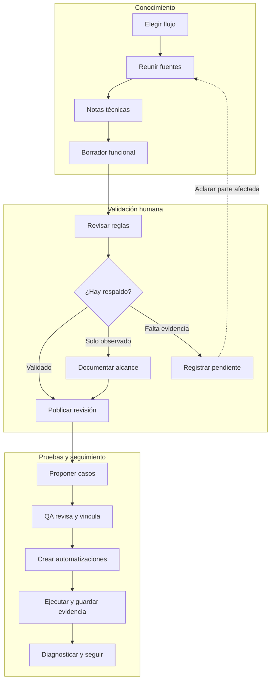
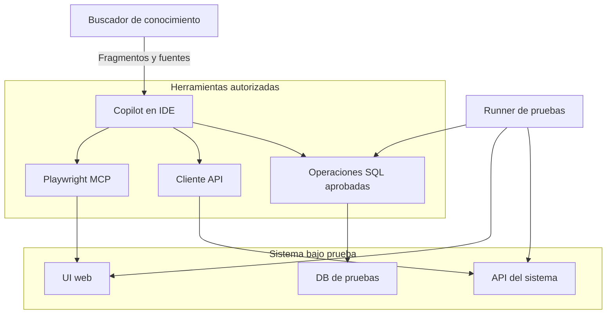
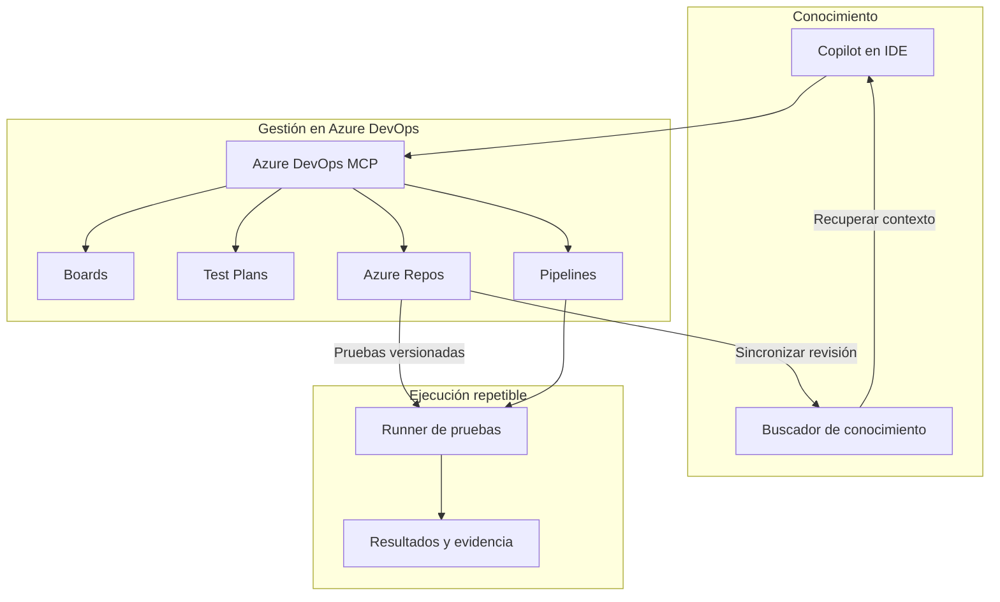
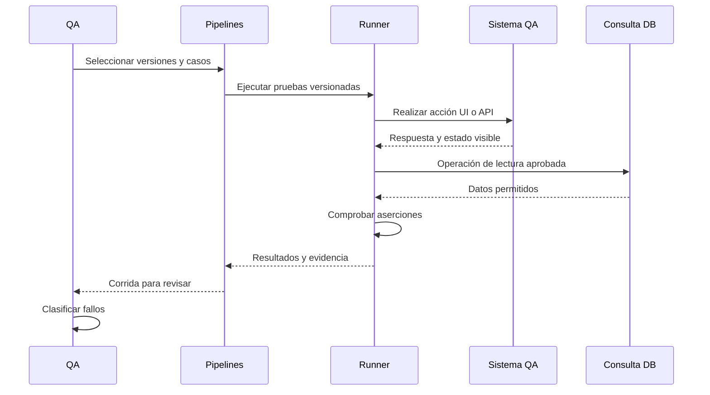
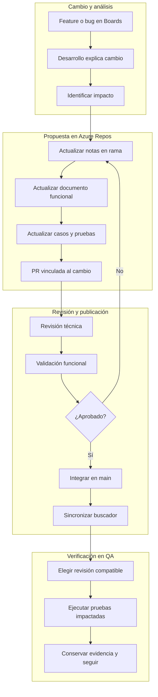
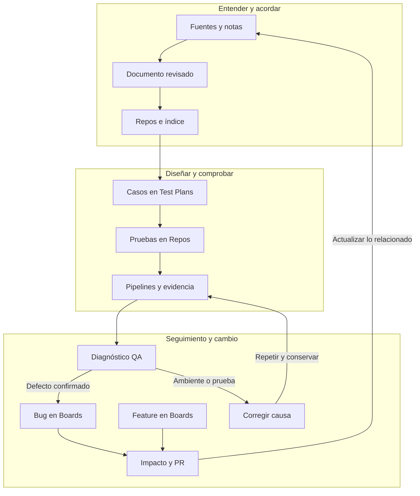

# Proceso de QA agentizada

**Documento de referencia · Propuesta para implementar y evaluar por flujo**  
**Fecha:** 30 de septiembre de 2026  
**Destinatarios:** QA, automatizaciones, desarrollo, negocio y responsables de conocimiento.

Este documento describe el proceso acordado, sus responsabilidades y los criterios para avanzar. Las conexiones y controles propuestos deben verificarse en el entorno real: este documento no acredita que estén instalados o configurados. Los ejemplos de sistemas, reglas, identificadores y versiones son ficticios.

## Índice

1. [Qué buscamos y de dónde partimos](#1-qué-buscamos-y-de-dónde-partimos)
2. [Principios y alcance](#2-principios-y-alcance)
3. [Roles y decisiones](#3-roles-y-decisiones)
4. [Conocimiento confiable y documentación funcional](#4-conocimiento-confiable-y-documentación-funcional)
5. [Proceso inicial por flujo](#5-proceso-inicial-por-flujo)
6. [Arquitectura y conexiones](#6-arquitectura-y-conexiones)
7. [Ejecución, evidencia y diagnóstico](#7-ejecución-evidencia-y-diagnóstico)
8. [Mantenimiento por feature o bug](#8-mantenimiento-por-feature-o-bug)
9. [Visión integral](#9-visión-integral)
10. [Ejemplo de punta a punta](#10-ejemplo-de-punta-a-punta)
11. [Primer MVP y criterios de aceptación](#11-primer-mvp-y-criterios-de-aceptación)
12. [Medición y escalado](#12-medición-y-escalado)
13. [Anexo: modelos de artefactos](#13-anexo-modelos-de-artefactos)
14. [Glosario](#14-glosario)
15. [Fuentes oficiales y alcance de la verificación](#15-fuentes-oficiales-y-alcance-de-la-verificación)

## 1. Qué buscamos y de dónde partimos

**QA**, por *Quality Assurance* o aseguramiento de calidad, es el trabajo de comprobar que un sistema cumple lo esperado y de prevenir problemas. **Agentizar** parte de ese trabajo significa usar inteligencia artificial (IA) que puede consultar información, proponer tareas y operar herramientas habilitadas. Las personas siguen decidiendo qué comportamiento corresponde, qué cobertura hace falta y qué pruebas se aceptan.

El objetivo es aumentar la capacidad del equipo de automatizaciones de pruebas. Cada colaborador ya cuenta con GitHub Copilot en su computadora. El equipo ya recibió un **workbook**, una guía de instrucciones y procedimientos, para que Copilot genere casos, ejecute pruebas, produzca reportes y deje documentos Markdown con posibles defectos para que desarrollo pueda reproducirlos y corregirlos. **Markdown** es un formato de texto sencillo que permite organizar documentos con títulos, tablas y enlaces.

Partimos de ese trabajo y lo ampliamos con conocimiento confiable, documentación funcional, relaciones entre artefactos y mantenimiento. No se reemplaza la experiencia del equipo ni se exige comenzar de cero.

Para alguien que no trabaja en tecnología, el recorrido puede entenderse así:

1. Reunimos lo que sabemos del sistema y anotamos de dónde sale cada dato.
2. Copilot convierte esa información en una explicación del proceso de negocio.
3. Una persona que conoce el proceso confirma las reglas críticas y aclara las dudas.
4. Copilot propone situaciones para probar y QA revisa qué debería pasar.
5. El equipo convierte las situaciones aceptadas en pruebas que se pueden repetir.
6. Las pruebas se ejecutan, conservan evidencias y los fallos se investigan.
7. Cuando el sistema cambia, se actualizan los documentos y las pruebas relacionadas.

Por ejemplo, descubrir que el código devuelve stock al cancelar un pedido es útil. Todavía falta confirmar cuándo corresponde devolverlo: según el estado del pedido, la reserva de mercadería y las excepciones del proceso. **El comportamiento actual y la regla de negocio correcta son cosas que deben comprobarse por separado.**

## 2. Principios y alcance

El proceso se aplica de manera iterativa a una aplicación, un módulo o un flujo. No se espera a documentar toda la compañía para empezar. Se priorizan los flujos críticos y la **regresión**, que consiste en repetir pruebas para detectar si un cambio dañó comportamientos que ya funcionaban.

| Principio | Aplicación práctica |
| --- | --- |
| Reusar lo que sirve | Mantener el workbook, Copilot y las herramientas de automatización que el equipo ya utiliza cuando sean adecuadas. |
| Separar evidencia de suposición | Marcar lo observado, lo inferido y lo pendiente; no convertir una inferencia en regla confirmada. |
| Revisar en partes pequeñas | Pedir validación de reglas concretas y ambigüedades, sin exigir que negocio escriba toda la documentación desde cero. |
| Conservar relaciones | Poder seguir el camino desde una regla hasta el caso, la prueba, la corrida y un eventual defecto. |
| Fijar versiones | Usar conocimiento y pruebas compatibles con el sistema desplegado en el ambiente que se está probando. |
| Repetir pruebas aceptadas | Copilot ayuda a crear y mantener; un ejecutor de pruebas repite el código versionado. |
| Investigar los fallos | Un resultado rojo puede indicar un defecto del producto, del ambiente o de la propia prueba. |
| Medir el resultado real | Incluir revisión, retrabajo y mantenimiento al evaluar capacidad y calidad. |

Se incluyen sistemas actuales y **legacy**, es decir, sistemas antiguos que siguen en uso, algunos con alrededor de diez años de evolución. La metodología puede ser la misma; las herramientas dependen de cada tecnología. Playwright permite automatizar navegadores web. No se lo presenta como una herramienta para automatizar aplicaciones de escritorio. Para esos sistemas se evalúan las herramientas existentes y alternativas compatibles. [Fuente: Playwright MCP](https://github.com/microsoft/playwright-mcp).

Las verificaciones pueden combinar:

- **UI**, o interfaz de usuario: lo que una persona ve y opera en una aplicación web.
- **API**, o interfaz de programación: operaciones que un sistema expone para intercambiar datos. Cada dirección u operación accesible se suele llamar **endpoint**.
- **DB**, o base de datos: información persistida que se consulta mediante operaciones autorizadas.

No todos los casos necesitan los tres niveles. QA elige la combinación según el riesgo y el comportamiento que quiere comprobar.

## 3. Roles y decisiones

Los roles indican responsabilidades; una misma persona puede cumplir más de uno. No se propone una cantidad de empleados ni una estructura organizativa nueva.

| Rol | Responsabilidad principal | Qué acepta o confirma |
| --- | --- | --- |
| Desarrollo | Aportar código, contratos, cambios y dependencias; corregir defectos confirmados. | Exactitud técnica de las notas y alcance técnico del cambio. |
| QA / analista de pruebas | Definir riesgos y cobertura; revisar resultados esperados; investigar fallos. | Casos de prueba, suficiencia de evidencia y clasificación del fallo. |
| Negocio o conocedor del proceso | Aclarar reglas, estados y excepciones. Puede ser alguien con conocimiento operativo del sistema. | Corrección funcional de las reglas dentro de su alcance. |
| Responsable de conocimiento | Coordinar fuentes, pendientes, revisión, publicación y sincronización. | Que la revisión publicada tenga estado, versión y relaciones identificables. |
| Equipo de automatizaciones | Crear o revisar código de pruebas, datos, verificaciones y ejecución repetible. | Pruebas reutilizables y configuración del ejecutor. |
| Copilot | Proponer notas, borradores, casos, automatizaciones y diagnósticos; utilizar herramientas permitidas. | No reemplaza la aceptación técnica o funcional de las personas responsables. |

**Runner** es el programa que ejecuta las pruebas. No es un rol que valida reglas de negocio. Una vez aceptada una prueba, el runner puede ejecutarla sin pedir una nueva revisión humana del documento en cada corrida. La revisión vuelve a ser necesaria cuando cambian las reglas, las expectativas o aparece una ambigüedad relevante.

## 4. Conocimiento confiable y documentación funcional

### 4.1. Segundo cerebro técnico

El **segundo cerebro** es un conjunto de notas Markdown pequeñas y conectadas. Describe la aplicación, sus componentes técnicos, dependencias, reglas identificadas y dudas. No requiere adoptar una metodología con un nombre específico.

Copilot ya genera este tipo de notas. Para este proceso deben apoyarse en las fuentes disponibles: código, contratos de APIs, estructuras y datos permitidos, tickets, documentos existentes y observaciones del sistema. La ausencia de documentación funcional se trabaja con esas fuentes, sin fingir que alcanzan para confirmar todas las reglas de negocio.

Cada nota debe conservar:

| Campo | Para qué sirve |
| --- | --- |
| Identificador y tema | Encontrarla y vincularla desde otras notas o casos. |
| Fuentes | Distinguir código, contrato, ticket, observación y confirmación humana; incluir referencias concretas. |
| Estado | Indicar el nivel de respaldo de cada afirmación. |
| Versión del sistema | Saber a qué comportamiento o despliegue aplica. |
| Relaciones | Conectar dependencias, reglas, notas, casos y cambios. |
| Responsable de validación | Identificar la persona o el rol que debe confirmar el contenido. |
| Revisión del documento | Recuperar el contenido exacto que se usó, mediante Git. |

**Git** es un sistema que conserva el historial de cambios de archivos. Una **revisión** o *commit* identifica una versión concreta de ese historial. Azure Repos será la fuente versionada de referencia.

### 4.2. Estados del conocimiento

| Estado | Significado | Uso en pruebas |
| --- | --- | --- |
| Validado | Una persona responsable confirmó la afirmación dentro de una versión y un alcance definidos. | Puede respaldar resultados esperados de corrección funcional. |
| Observado | Hay evidencia del comportamiento actual, sin confirmación de que sea el correcto para negocio. | Puede respaldar pruebas de caracterización o regresión, claramente identificadas. |
| Inferido | La IA o una persona deduce algo a partir de fuentes, pero falta evidencia suficiente. | Sirve para formular preguntas y propuestas; no se usa como expectativa confirmada. |
| Pendiente | Falta información, acceso o una decisión. | Se registra la duda y su impacto; se continúa con las partes que sí tienen respaldo. |

El estado debe aplicarse a las afirmaciones o reglas. Si una nota contiene una regla validada y una excepción pendiente, se distinguen ambas; no se etiqueta todo como validado.

Una **prueba de caracterización** registra cómo se comporta hoy un sistema. Si nadie puede confirmar una regla, se puede conservar ese comportamiento como observado y crear una prueba para detectar cambios. Su resultado no demuestra que el comportamiento sea correcto para negocio. Esto permite avanzar sin bloquear todo el proyecto por documentación incompleta.

### 4.3. Borrador funcional y validación focalizada

La **documentación funcional** explica qué hace el proceso para sus usuarios: objetivo, participantes, condiciones previas, pasos, reglas, resultados y excepciones. Copilot genera un borrador a partir del segundo cerebro técnico y separa observaciones de inferencias.

QA, negocio o un conocedor revisan partes pequeñas. Por ejemplo: “Para un pedido confirmado con una reserva activa, ¿la cancelación libera esa reserva? ¿Qué ocurre si el pedido ya fue despachado?”. La revisión deja una decisión y una fuente, no solamente una aprobación genérica de todo el archivo.

La documentación funcional validada define **qué debe pasar**. El segundo cerebro técnico ayuda a definir **cómo comprobarlo**: mediante una pantalla, una respuesta de API o un dato persistido.

Se puede usar el mismo modelo de IA en sesiones separadas o modelos distintos para construir conocimiento y generar casos. Ninguna opción es obligatoria. Dos modelos pueden repetir el mismo error si parten de una nota equivocada. La validación necesita una fuente independiente o alguien que conozca el proceso.

### 4.4. Publicación y recuperación de conocimiento

El **buscador de conocimiento —RAGFlow si es la herramienta elegida—** permite recuperar fragmentos relevantes de documentos para que Copilot los use como contexto. **RAG**, por recuperación aumentada para generación, consiste en buscar información y aportarla al modelo antes de generar una respuesta. El producto mencionado por voz todavía debe confirmarse.

Azure Repos conserva la revisión de referencia. El buscador indexa una copia de esa revisión: **indexar** significa preparar el contenido para encontrarlo mediante búsquedas. Subir un documento al buscador no equivale a versionarlo con Git.

La configuración documentada de RAGFlow contempla metadatos y su uso en filtros de recuperación. **Metadatos** son atributos como sistema, versión o estado. Es necesario comprobar esas capacidades en la versión instalada y configurar los campos del piloto; no se da por instalada una integración con Copilot. [Fuente: configuración de conocimiento de RAGFlow](https://github.com/infiniflow/ragflow/blob/main/docs/guides/dataset/configuration.md).

El circuito propuesto es:

1. Publicar en Repos el contenido aprobado, conservando pendientes explícitos.
2. Sincronizar en el buscador la misma revisión e identificar qué revisión quedó indexada.
3. Buscar con filtros de sistema, versión y estado; para expectativas funcionales usar reglas validadas.
4. Recuperar también precondiciones, excepciones y dependencias, no solo la regla principal.
5. Comprobar que los fragmentos necesarios aparecen. Si faltan, consultar las fuentes versionadas y corregir la recuperación antes de aceptar casos.

El buscador devuelve fragmentos relevantes, no una garantía de conocimiento completo. El piloto debe probar consultas representativas y detectar omisiones o mezcla de versiones. El contenido observado puede permanecer disponible para caracterización, con su estado visible y separado de las reglas validadas.

## 5. Proceso inicial por flujo

Este circuito se repite por cada flujo seleccionado. Si una etapa descubre una duda, se vuelve a la parte que necesita aclaración. Se puede seguir trabajando en otros casos con respaldo suficiente.



La salida “solo observado” habilita casos de caracterización. La salida “validado” habilita casos que comprueban corrección funcional. El contenido pendiente se conserva y no se usa como expectativa confirmada.

### 5.1. Etapas, entradas y criterios para seguir

| Etapa | Entradas | Responsables | Salidas | Criterio para seguir |
| --- | --- | --- | --- | --- |
| 1. Construir segundo cerebro técnico | Flujo elegido, código, contratos, tickets, datos y accesos disponibles. | Copilot prepara; desarrollo y responsable de conocimiento revisan fuentes. | Notas con comportamiento, dependencias, fuentes, estados y dudas. | Las afirmaciones usadas tienen referencia y versión; las dudas son visibles. |
| 2. Generar borrador funcional | Notas técnicas y documentos existentes. | Copilot prepara; QA organiza la revisión. | Objetivo, precondiciones, reglas, resultados y excepciones; observaciones e inferencias separadas. | El borrador permite revisar reglas concretas y señala lo que falta. |
| 3. Validar y publicar | Borrador, evidencia y preguntas focalizadas. | Negocio o conocedor valida; desarrollo revisa lo técnico; responsable de conocimiento publica. | Contenido aprobado versionado, observaciones y pendientes identificados; copia indexada de la misma revisión. | Cada expectativa funcional tiene respaldo; si solo hay observación, el alcance se declara como caracterización. |
| 4. Proponer y revisar casos | Reglas aplicables, notas técnicas, riesgos y requisitos. | Copilot propone; QA acepta resultados esperados y cobertura. | Casos en Test Plans, relación con reglas/notas y requisitos o features de Boards. | No hay expectativa crítica basada solo en inferencias; cobertura y pendientes están explícitos. |
| 5. Crear automatizaciones | Casos aceptados, herramientas autorizadas y ambiente. | Copilot ayuda; equipo de automatizaciones revisa y acepta. | Código reutilizable, preparación de datos y aserciones versionadas. | La prueba comprueba lo esperado, controla sus datos y utiliza operaciones permitidas. |
| 6. Ejecutar y conservar | Revisión de pruebas, documentación compatible, datos y runner. | QA y automatizaciones; runner ejecuta. | Resultados, evidencias y versiones de la corrida. | Se puede reconstruir qué se ejecutó, contra qué sistema y con qué expectativa. Pruebas aceptadas pasan a Pipelines. |
| 7. Reportar y dar seguimiento | Resultados y evidencias. | Copilot propone diagnóstico; QA clasifica; desarrollo investiga y corrige. | Informe Markdown; bugs confirmados en Boards con relaciones; problemas de ambiente o prueba registrados. | Cada fallo tiene clasificación o investigación pendiente; no se da por bug todo resultado rojo. |
| 8. Mantener lo impactado | Feature, bug, cambios de regla, código o dependencia. | Desarrollo, conocimiento, negocio, QA y automatizaciones según alcance. | Notas, documentación, casos y pruebas actualizados; nueva revisión y evidencia. | El cambio fue revisado y probado; la versión publicada e indexada coincide. |

Una **aserción** es una verificación explícita de la prueba, por ejemplo “el pedido debe quedar cancelado”. Preparar datos no es una aserción: ambas tareas deben identificarse por separado.

### 5.2. Diseño y trazabilidad de casos

Un **caso de prueba** describe una situación, sus datos, pasos y resultado esperado. Una **automatización** es el código que ejecuta total o parcialmente ese caso. No son el mismo artefacto.

Desde la etapa de casos, QA vincula cada caso con las reglas o notas que lo originaron y con el requisito o la **feature**, una funcionalidad nueva o modificada, registrada en Boards. En Test Plans se organiza dentro de un plan y una **suite**, un grupo de casos.

La cobertura debe considerar camino principal, límites, errores, excepciones y efectos en dependencias. Que una API responda con un código HTTP exitoso no demuestra que haya aplicado bien una regla: también hay que revisar valores, estados y efectos.

La asociación entre pruebas automáticas, casos y resultados debe configurarse y verificarse con el framework y el mecanismo de publicación elegidos. Un **framework** es la estructura de herramientas usada para escribir y ejecutar pruebas. Publicar un reporte de pipeline no garantiza por sí solo todas las asociaciones en Test Plans. Azure documenta mecanismos de publicación de resultados y asociación con casos. [Fuente: pruebas automatizadas con Azure Test Plans](https://learn.microsoft.com/en-us/azure/devops/test/automated-testing-overview?view=azure-devops).

## 6. Arquitectura y conexiones

### 6.1. Responsabilidad de cada componente

| Componente | Qué conserva o hace en el proceso |
| --- | --- |
| Workbook | Instrucciones reutilizables para pedir y revisar trabajo de Copilot. |
| Copilot en el IDE | Propone, genera y mantiene artefactos; consulta contexto y usa herramientas habilitadas. **IDE** es el entorno donde se trabaja con código. |
| Azure Boards | Trabajo, requisitos, features y bugs, con sus estados y relaciones. |
| Azure Test Plans | Casos, planes, suites y resultados asociados según la configuración elegida. |
| Azure Repos | Historial Git de notas, documentos, código y pruebas. Fuente versionada de referencia. |
| Azure Pipelines | Ejecuciones repetibles y conservación/publicación de resultados y artefactos. Una **pipeline** es una secuencia configurada de tareas. |
| Buscador de conocimiento | Índice consultable de una revisión identificada de documentos; no reemplaza el historial Git. |
| Herramientas UI/API/DB | Interacciones y verificaciones concretas contra el ambiente permitido. |

Un **artefacto** es un archivo o resultado producido por el proceso, como un documento, un reporte o una traza. Una **traza** registra acciones y detalles de una ejecución para investigarla.

### 6.2. Mapa de conexiones propuestas

El mapa se divide en dos diagramas para facilitar la lectura. Primero, las herramientas que permiten consultar o probar el sistema:



Luego, la gestión del trabajo, el versionado y la ejecución:



Las flechas representan conexiones deseadas y responsabilidades, no integraciones instaladas ni permisos concedidos. En particular, Azure DevOps MCP depende del catálogo disponible, la versión, el cliente y los permisos. El workbook guía el trabajo de Copilot y las personas responsables revisan sus propuestas antes de aceptarlas. Los resultados se publican y asocian mediante el mecanismo configurado, como se explica en la sección de ejecución.

**MCP**, por *Model Context Protocol*, es una interfaz que permite al asistente descubrir y utilizar herramientas. No otorga permisos por sí misma ni garantiza que todas las operaciones estén disponibles.

### 6.3. UI web

El workbook utiliza Playwright MCP para interactuar con interfaces web. En el piloto se comprueban cliente, navegador, acceso al ambiente y herramientas habilitadas. Copilot puede explorar un flujo y ayudar a depurar una prueba. La salida aceptada debe ser código reutilizable en Repos. La regresión se ejecuta con ese código, sin recrear cada vez una exploración libre del modelo. [Fuente: Playwright MCP](https://github.com/microsoft/playwright-mcp).

### 6.4. APIs y contratos

**Swagger/OpenAPI** aporta una descripción técnica de APIs: operaciones, parámetros y formatos. Copilot o el runner envían **requests**, solicitudes a la API, mediante el cliente del framework elegido. El contrato ayuda a saber cómo invocar la operación; la documentación funcional validada define qué resultado corresponde.

QA revisa contenido de la respuesta, límites, excepciones, errores y efectos. Por ejemplo, un “éxito” al cancelar un pedido no alcanza si el estado persistido o la reserva no cambian como corresponde.

### 6.5. Consultas a DB con límites efectivos

**SQL** es un lenguaje para consultar y modificar datos. **SELECT** es una operación de lectura. La propuesta para el agente es un catálogo de operaciones con SQL fijo y parámetros validados; no un campo de SQL libre.

Por ejemplo, Copilot elige `consultar_estado_pedido` y aporta un identificador válido. El ejecutor aplica una consulta previamente aprobada. Puede exponerse mediante un script, una **CLI** —herramienta de línea de comandos— o un **wrapper**, una capa que ofrece operaciones controladas, eventualmente como herramienta MCP.

Los límites se aplican en la conexión, la DB y el ejecutor protegido:

- Ambiente permitido y cuenta con permisos mínimos de lectura.
- Operaciones y parámetros autorizados; límites de tiempo y cantidad de resultados.
- Scripts protegidos para que el agente no pueda cambiarlos y ampliar sus capacidades.
- Credenciales y rutas de acceso controladas para que el agente no use otra conexión con más permisos.

Los scripts por sí solos no imponen el límite si el agente puede modificarlos o conectarse por otra vía. Las credenciales no se incorporan a notas, casos ni evidencias.

Si preparar datos requiere escritura, se usa un circuito específico autorizado en el ambiente de pruebas, con sus propios permisos y controles. Esa preparación no se atribuye a una operación SELECT ni a la conexión de lectura.

### 6.6. Azure DevOps MCP

Se propone usar el servidor oficial de Azure DevOps MCP para las operaciones disponibles sobre Boards, Test Plans, Repos y Pipelines. Es distinto del Azure MCP dedicado a recursos cloud. Antes de depender de una operación se revisan la autenticación, el catálogo, las herramientas habilitadas y los permisos del cliente concreto. [Fuente: descripción oficial de Azure DevOps MCP](https://learn.microsoft.com/en-us/azure/devops/mcp-server/mcp-server-overview?view=azure-devops).

El catálogo oficial consultado incluye operaciones de elementos de trabajo, PR, pipelines y planes/casos de prueba. No se presupone que el cliente instalado exponga toda esa lista ni que complete cualquier asociación requerida. Si una operación falta, el equipo puede usar el portal, Git o un mecanismo aprobado y conservar la misma trazabilidad. [Fuente: catálogo del servidor local](https://github.com/microsoft/azure-devops-mcp/blob/main/docs/TOOLSET.md).

## 7. Ejecución, evidencia y diagnóstico

### 7.1. Antes y durante una corrida

Una **corrida** es una ejecución identificable de una o varias pruebas. Antes de iniciarla, se comprueba la correspondencia entre sistema desplegado, documentación, pruebas y datos. Se registran como mínimo:

| Dato | Ejemplo ficticio |
| --- | --- |
| Sistema y ambiente | Pedidos 2.4, ambiente QA. |
| Revisión de conocimiento/documentación | Commit `abc123` compatible con 2.4. |
| Revisión de pruebas | Commit `def456`. |
| Casos y reglas | `CASO-001`, `REGLA-001`. |
| Datos y preparación | Pedido de prueba, estado inicial y revisión del mecanismo de preparación. |
| Runner y configuración | Versión del framework, navegador si aplica y configuración relevante sin secretos. |
| Ejecución | Identificador de corrida, fecha, resultado y enlaces a evidencias. |

La evidencia debe incluir precondiciones, pasos y datos, resultado esperado con su respaldo, resultado observado y los elementos necesarios para reproducir. Según el caso: capturas, logs —registros de eventos—, trazas, solicitudes/respuestas API y resultado de una consulta permitida. Se conserva lo necesario con acceso adecuado; los documentos no deben copiar credenciales ni datos sensibles innecesarios.

### 7.2. Secuencia de una ejecución repetible



El ejemplo muestra una prueba que necesita DB. En otro flujo puede bastar una API o la UI. La preparación de datos ocurre por el mecanismo autorizado elegido, antes de las verificaciones.

Pipelines conserva artefactos y publica resultados mediante la configuración elegida. La vista de resultados en Test Plans depende de la asociación y del mecanismo compatibles, que deben probarse durante el MVP. [Fuente: pruebas automatizadas con Azure Test Plans](https://learn.microsoft.com/en-us/azure/devops/test/automated-testing-overview?view=azure-devops).

### 7.3. Un fallo requiere diagnóstico

Copilot puede redactar el informe Markdown y proponer hipótesis; QA revisa el respaldo y clasifica:

| Clasificación | Ejemplo | Acción |
| --- | --- | --- |
| Defecto de producto confirmado | Una cancelación permitida no libera la reserva según la regla validada. | Crear o actualizar bug en Boards, adjuntar evidencia y vincular regla, caso, prueba y corrida. |
| Problema de ambiente | La API no está disponible o QA tiene una configuración incompatible. | Registrar el incidente, corregir el ambiente y repetir conservando el resultado original. |
| Problema de prueba | El localizador de UI apunta a otro elemento o la preparación dejó un estado incorrecto. | Corregir la automatización o los datos, revisar y ejecutar de nuevo. |
| Pendiente de diagnóstico | No se puede distinguir todavía entre las causas. | Registrar qué falta y quién investiga; no presentar la hipótesis como defecto confirmado. |

Un **bug** es un defecto. Para que desarrollo lo reproduzca, el registro debe describir ambiente y versiones, precondiciones, datos, pasos, esperado con fuente, observado, impacto y evidencia. Los vínculos permiten seguir el diagnóstico sin depender de un relato aislado.

**No se cambia un resultado esperado solamente para que una prueba pase.** Si la regla cambió, se valida y se actualiza por el proceso de mantenimiento. Las nuevas corridas no borran los fallos ni las evidencias anteriores.

## 8. Mantenimiento por feature o bug

### 8.1. Circuito de actualización

Una feature se registra en Boards con el cambio esperado y la versión objetivo. Un bug confirmado también inicia este circuito cuando su corrección afecta conocimiento o pruebas. Desarrollo aporta qué cambió y las dependencias; el responsable de conocimiento coordina el impacto.

Una **rama** de Git permite preparar cambios separados de la versión principal. Una **PR**, por *pull request*, es una propuesta de cambio para revisar antes de integrar. **Main** es el nombre habitual de la rama principal.



Las revisiones técnica y funcional pueden organizarse en paralelo cuando sean independientes. El diagrama las muestra consecutivas para facilitar la lectura. El criterio es contar con ambas antes de publicar el cambio aplicable.

Los casos en Test Plans se actualizan de forma coordinada con la revisión de documentación y código; deben registrar qué versión respaldan. “Actualizar casos y pruebas” en el diagrama agrupa esos artefactos, no significa que Test Plans sea un archivo Git.

Azure Repos ofrece políticas para revisores y vínculos con elementos de trabajo. Se propone configurarlas según las responsabilidades del equipo, sin dar por hecho que estén habilitadas ni prescribir cambios directos en main. [Fuente: políticas de ramas de Azure Repos](https://learn.microsoft.com/en-us/azure/devops/repos/git/branch-policies-overview?view=azure-devops).

### 8.2. La versión más nueva no siempre corresponde al ambiente

Los analistas obtienen la revisión de documentación y conocimiento que corresponde a la versión del sistema bajo prueba. Hacer siempre “pull de lo último” —descargar la última versión de main— puede traer reglas de una feature que aún no se desplegó en QA.

**Ejemplo ficticio:** la versión 2.4 admite un descuento máximo del 10%. Desarrollo prepara la 2.5 con un máximo del 15% y la documentación ya está integrada en main. Si QA todavía ejecuta la 2.4, debe usar reglas del 10% y la revisión documental compatible con 2.4. Probar contra el 15% produciría una conclusión equivocada.

Para evitarlo:

1. Identificar la versión real del sistema y el ambiente.
2. Seleccionar una revisión concreta de conocimiento/documentación compatible, no solo una rama cuyo contenido puede cambiar.
3. Recuperar esa misma revisión o versión en el buscador y registrar cuál se utilizó.
4. Seleccionar pruebas y datos compatibles; registrar sus revisiones en la corrida.
5. Actualizar expectativas únicamente con validación del cambio funcional.

### 8.3. Qué revisar cuando cambia algo

Las relaciones regla → caso → prueba permiten identificar qué actualizar. Se revisan también dependencias: un cambio en reservas puede afectar cancelaciones aunque la pantalla siga igual.

El mantenimiento conserva historial y evidencia. Si el buscador no terminó de sincronizarse o devuelve una versión equivocada, se usa la fuente versionada compatible y se corrige el índice. No se acepta una mezcla silenciosa de revisiones. Cuando un bug se corrige, se verifica la corrección y se ejecuta regresión sobre los flujos relacionados; si la regla funcional sigue igual, se conserva su expectativa.

## 9. Visión integral

Este diagrama conecta construcción inicial, revisión, ejecución, seguimiento y mantenimiento. Los diagramas anteriores detallan cada responsabilidad.



El documento revisado incluye la validación humana y la identificación explícita de observaciones y pendientes. Cada generación de casos usa reglas validadas para corrección funcional y observaciones identificadas para caracterización. Cada corrida fija versiones; el runner ejecuta y los resultados se publican y asocian según la configuración elegida. La flecha de mantenimiento vuelve al conocimiento y recorre las actualizaciones de documentos, casos y pruebas impactados; no obliga a regenerar todo el sistema. La publicación en el buscador no reemplaza las relaciones entre artefactos ni el historial en Repos.

## 10. Ejemplo de punta a punta

**Caso ilustrativo ficticio: cancelar un pedido y liberar su reserva de stock.** Los números, nombres e identificadores siguientes no representan reglas reales de la compañía.

### 10.1. Descubrir el comportamiento

Se elige el flujo porque una cancelación incorrecta puede dejar mercadería reservada. Copilot consulta el código de cancelación, el contrato API, un ticket disponible y consultas SELECT aprobadas. Encuentra que la cancelación cambia el estado y libera una reserva.

Se crea `NOTA-001`: “el código observado libera una reserva al cancelar”. La nota apunta a la revisión del código, señala la versión del sistema y conserva las dudas: ¿se permite cancelar pedidos despachados?, ¿qué ocurre si ya se canceló?, ¿cuándo existe una reserva activa?

### 10.2. Proponer y confirmar la regla

Copilot redacta un borrador funcional. El conocedor del proceso confirma, para este ejemplo:

- Un pedido confirmado, no despachado y con reserva activa puede cancelarse.
- La cancelación cambia el estado a cancelado y libera una sola vez su reserva.
- Un pedido despachado no admite esa operación.
- Repetir la cancelación no debe liberar stock por segunda vez.

Se publica `REGLA-001` con estado validado, fuente de confirmación y versión aplicable. Queda pendiente el tratamiento de una cancelación parcial: no se inventa la regla. Si se caracteriza su comportamiento actual, se lo identifica como observado y con alcance separado.

### 10.3. Diseñar casos y relaciones

Copilot propone y QA acepta:

| Caso ficticio | Qué comprobar | Respaldo |
| --- | --- | --- |
| CASO-001 | Cancelar un pedido permitido cambia el estado y libera la reserva. | REGLA-001, precondiciones y nota técnica. |
| CASO-002 | Cancelar un pedido despachado devuelve el error definido y conserva estado y reserva. | Excepción validada de REGLA-001. |
| CASO-003 | Repetir la cancelación no libera stock dos veces. | Regla validada sobre repetición. |

Los casos se registran en Test Plans y se relacionan con el requisito o feature de Boards desde esta etapa. Cada uno apunta a la revisión de la regla que justifica su esperado.

### 10.4. Automatizar y ejecutar

Para CASO-001, el equipo elige una acción por UI web y verificaciones de API/DB porque aportan evidencia sobre estado y reserva. Podría elegir API como acción principal si alcanza para el alcance definido.

La preparación autorizada crea un pedido confirmado con reserva activa de dos unidades. Una operación de lectura aprobada consulta el estado inicial y el disponible. La prueba cancela el pedido y verifica el estado final y la liberación de la reserva según el modelo de datos real. Por ejemplo, si el disponible inicial es ocho y liberar la reserva agrega dos, se esperan diez; ese cálculo debe estar respaldado por la regla y el significado de los campos, no deducido solamente por el nombre de una columna.

Copilot ayuda a construir el código; automatizaciones lo revisa, acepta y guarda en Repos. El runner lo ejecuta en Pipelines. La corrida identifica sistema, ambiente, revisiones de documentos/pruebas, datos y configuración. Guarda captura o traza, respuesta API y consulta permitida según lo necesario.

### 10.5. Investigar un fallo y verificar la corrección

La UI muestra “cancelado”, pero la reserva sigue activa. QA descarta datos iniciales incorrectos, versiones incompatibles y problemas del script. Con la regla validada y evidencia suficiente confirma un defecto de producto y registra el bug en Boards. El informe incluye los pasos y vínculos para que desarrollo lo reproduzca.

Desarrollo corrige la liberación de reserva. Se revisa el impacto sobre notas técnicas y pruebas; la regla funcional no cambia, por lo que no se altera su esperado. Una PR vinculada al bug actualiza lo necesario. Luego se ejecutan CASO-001 y los casos relacionados, se conserva la nueva evidencia y se sigue el estado del bug en Boards.

Si luego una feature habilita cancelaciones parciales, comienza una nueva validación de esa regla antes de actualizar expectativas, documentos y pruebas. La publicación se realiza con la versión objetivo, y QA usa esa revisión cuando el cambio esté desplegado en su ambiente.

## 11. Primer MVP y criterios de aceptación

**MVP**, o producto mínimo viable, es aquí un piloto acotado que permita comprobar el circuito completo. Es una propuesta, no un sistema ya implementado.

Se selecciona una aplicación y pocos flujos críticos. Conviene elegir un flujo UI o API con una verificación DB si esa combinación es relevante y está autorizada. Se reusan el workbook, Copilot, Azure y las prácticas del equipo. No se espera a incorporar todas las aplicaciones.

### 11.1. Preparación del piloto

| Aspecto | Comprobación necesaria |
| --- | --- |
| Alcance | Flujo, riesgos, versiones y ambiente seleccionados. |
| Cliente e IDE | Copilot disponible en el cliente elegido; modo y soporte de herramientas comprobados. |
| Tecnologías | UI web, API, DB o escritorio identificados; herramientas existentes evaluadas. |
| Azure | Servicios utilizados, permisos y mecanismo de registro/publicación verificados. No se dan por confirmadas licencias o habilitaciones adicionales. |
| MCP | Catálogo real, autenticación y operaciones necesarias probadas con el cliente elegido. |
| DB | Operaciones aprobadas, conexión de lectura y límites efectivos; preparación con escritura por circuito separado si hace falta. |
| Conocimiento | Producto del buscador confirmado; filtros, revisiones y recuperación comprobados, si se incorpora al piloto. |
| Responsables | Persona o rol para validar reglas, revisar pruebas y coordinar publicación identificado. |
| Medición | Línea base y criterios de aceptación acordados antes de comparar resultados. |

El piloto debe verificar el buscador elegido para aceptar esa parte de la propuesta. Mientras se resuelve su conexión, se puede avanzar con documentos versionados consultados directamente y registrar la integración como pendiente.

### 11.2. Entregables y aceptación

| Entregable | Evidencia para aceptarlo |
| --- | --- |
| Segundo cerebro y documentación funcional | Versionados, con fuentes, estados, relaciones y responsable; pendientes visibles. |
| Casos trazables | QA revisó cobertura y esperados; casos vinculados con reglas/notas y requisitos/features desde su diseño. |
| Prueba reutilizable | Código aceptado, datos y aserciones definidos, herramientas y operaciones permitidas. |
| Ejecución repetible | Runner en Pipelines, resultado y artefactos conservados; versiones registradas; repetición evaluada bajo condiciones acordadas. |
| Diagnóstico y seguimiento | Fallos clasificados y bugs confirmados registrados si aparecen; la ausencia de bugs no invalida el piloto. |
| Recuperación de conocimiento | Consultas del piloto recuperan reglas, precondiciones, excepciones y dependencias de la revisión correcta, sin mezclar estados. |
| Mantenimiento probado | Un cambio real o un ejercicio controlado recorre impacto, PR, validación, publicación, sincronización y actualización de casos/pruebas. |

QA y automatizaciones acuerdan umbrales de estabilidad, cobertura y recuperación antes de evaluar el piloto. No se fijan porcentajes arbitrarios ni se declara exitoso porque una sola corrida pasó. Se debe demostrar el circuito y registrar los problemas que todavía necesitan resolución.

## 12. Medición y escalado

La **línea base** es una medición del proceso actual que sirve para comparar el piloto. Se mide sobre trabajos de alcance y dificultad comparables; si cambian las condiciones, se anotan para interpretar los resultados.

| Métrica | Qué registrar | Qué permite evaluar |
| --- | --- | --- |
| Tiempo total por automatización aceptada | Preparación, generación, revisión, retrabajo y mantenimiento, además de tiempo de ejecución. | Esfuerzo real del ciclo, sin contar solamente lo que genera la IA. |
| Estabilidad | Fallos intermitentes y sus causas sobre corridas comparables; un fallo intermitente cambia de resultado sin un cambio que lo justifique. | Si la regresión es confiable o consume tiempo de diagnóstico. |
| Cobertura crítica | Flujos y reglas críticas con casos aceptados y pruebas ejecutadas, con pendientes explícitos. | Qué riesgos tienen respaldo y cuáles siguen descubiertos. |
| Defectos confirmados detectados | Defectos de producto con evidencia; separar problemas de ambiente y prueba. | Utilidad del circuito para encontrar problemas reales. |
| Calidad de recuperación | Consultas que recuperan todos los fragmentos necesarios; omisiones, mezcla de versiones/estados y fidelidad a fuentes. | Si el buscador aporta contexto suficiente para diseñar casos. |

No se prometen ahorros, retorno de inversión ni reducción de dotación. Los resultados deben salir de la comparación, incluyendo costos de revisión y mantenimiento.

Para escalar, primero se resuelven los problemas del piloto. Luego se amplían los flujos, se reutilizan modelos de notas/casos y operaciones aprobadas, y se incorpora otra aplicación con sus herramientas y permisos verificados. Se conserva el criterio de trabajar en incrementos pequeños y validar reglas críticas. No se establecen fechas ni plazos que el equipo no haya acordado.

## 13. Anexo: modelos de artefactos

Los siguientes modelos son propuestas simples. El equipo puede adaptarlos manteniendo fuentes, estados, versiones y relaciones. Los identificadores y rutas son ilustrativos.

### 13.1. Nota de conocimiento

```yaml
id: NOTA-001
titulo: Cancelación y reserva de stock
sistema: Pedidos
version_sistema: "2.4"
estado: observado
fuentes:
  - tipo: codigo
    referencia: "repositorio/ruta/archivo y commit concreto"
  - tipo: observacion
    referencia: "corrida y evidencia concreta"
responsable_validacion: "rol conocedor del proceso"
relaciones:
  - REGLA-001
  - NOTA-DEPENDENCIA-001
revision_documental: "commit registrado al publicar"
```

El cuerpo de la nota agrega comportamiento, alcance, precondiciones, excepciones y preguntas pendientes. Una regla confirmada debe incluir la fuente de validación y su alcance. Los campos de sistema, versión y estado son candidatos a filtros del buscador; su carga y funcionamiento se verifican en el producto elegido.

### 13.2. Caso de prueba

| Campo | Contenido propuesto |
| --- | --- |
| ID y título | CASO-001 — Cancelación permitida libera reserva. |
| Tipo de respaldo | Corrección funcional validada o caracterización observada. |
| Requisito/feature | ID y enlace de Boards. |
| Reglas/notas fuente | IDs, enlaces y revisión aplicable. |
| Sistema/versión | Versión compatible y ambiente objetivo. |
| Precondiciones y datos | Estado inicial, reservas y mecanismo de preparación. |
| Pasos | Acciones numeradas, con parámetros necesarios. |
| Esperado | Estado final y efectos, con fuente por expectativa. |
| Cobertura | Camino principal, límite o excepción que representa. |
| Revisión QA | Responsable, decisión y pendientes. |
| Automatización | Archivo/identificador de prueba y revisión Git, cuando exista. |

### 13.3. Informe de ejecución o bug

```text
Identificador de corrida:
Casos y pruebas ejecutados:
Sistema, versión y ambiente:
Revisión de conocimiento/documentación:
Revisión de pruebas, runner y configuración relevante:
Datos y preparación:
Precondiciones y pasos:
Esperado y fuente:
Observado:
Evidencias y enlaces:
Clasificación: producto / ambiente / prueba / pendiente
Impacto y responsable de seguimiento:
Bug de Boards, si está confirmado:
```

Cadena de referencia propuesta: **requisito/feature → regla/nota → caso → prueba → corrida → bug, si existe**. Los vínculos se conservan en los sistemas correspondientes y se pueden repetir en el informe para facilitar la lectura.

### 13.4. Manifiesto de corrida

Un **manifiesto** es un registro breve que identifica los elementos exactos usados. Puede guardarse con los artefactos de la pipeline.

```yaml
corrida: EJEMPLO-001
sistema: Pedidos
version_sistema: "2.4"
ambiente: QA
revision_conocimiento: abc123
revision_pruebas: def456
revision_preparacion_datos: ghi789
runner: "nombre y versión reales"
configuracion: "referencia sin secretos"
casos: [CASO-001, CASO-002, CASO-003]
revision_indice: "misma revisión de conocimiento, si se usó buscador"
evidencias: "enlaces a artefactos conservados"
```

## 14. Glosario

| Término | Significado en este proceso |
| --- | --- |
| Agentización | Uso de IA con contexto y herramientas para ejecutar partes del trabajo bajo responsabilidades y permisos definidos. |
| API / endpoint | Interfaz y operación accesible que permiten intercambiar datos entre sistemas. |
| Aserción | Comprobación explícita de un resultado dentro de una prueba. |
| Automatización | Código reutilizable que realiza acciones y verificaciones de un caso. |
| Bug | Defecto; se registra como confirmado cuando existe respaldo suficiente. |
| Caracterización | Prueba del comportamiento actual observado, sin afirmar corrección funcional. |
| Caso de prueba | Situación con precondiciones, datos, pasos y resultado esperado. |
| Contrato OpenAPI | Descripción técnica de cómo invocar una API y sus formatos. |
| Corrida | Ejecución identificable de pruebas con resultados y evidencia. |
| DB / SELECT | Base de datos / operación SQL de lectura. |
| Documentación funcional | Explicación de procesos, reglas, precondiciones, resultados y excepciones para el negocio y sus usuarios. |
| Feature | Funcionalidad nueva o modificada, con cambio esperado y versión objetivo. |
| Git / commit / rama | Historial de archivos / revisión concreta / línea de trabajo separada. |
| IDE | Entorno de trabajo con código donde el equipo usa Copilot. |
| Indexación / metadatos | Preparación del contenido para búsquedas / atributos para identificarlo y filtrarlo. |
| Legacy | Sistema antiguo que continúa en uso. |
| MCP | Interfaz de herramientas para asistentes; no concede permisos ni valida reglas. |
| MVP | Piloto acotado que comprueba el circuito completo y sus criterios de aceptación. |
| Pipeline / runner | Secuencia configurada de tareas / programa que ejecuta pruebas. |
| PR / main | Propuesta de cambio para revisión / rama principal del repositorio. |
| QA | Aseguramiento de calidad; en este proceso revisa cobertura, esperados y fallos. |
| RAG | Búsqueda de información relevante para aportar contexto al modelo. |
| Regresión | Repetición de pruebas para detectar daños provocados por cambios. |
| Segundo cerebro | Notas pequeñas y conectadas sobre aplicación, técnica, dependencias, reglas y dudas. |
| Suite | Grupo de casos dentro de la organización de pruebas. |
| Trazabilidad | Relaciones que permiten seguir de dónde sale una expectativa, cómo se prueba y qué resultado produjo. |
| Workbook | Guía de instrucciones y procedimientos que el equipo ya entregó para trabajar con Copilot. |

## 15. Fuentes oficiales y alcance de la verificación

Las fuentes se consultaron el **30 de septiembre de 2026** para comprobar capacidades documentadas. No se accedió a cuentas de Azure ni se verificó una instalación del equipo. La propuesta de proceso surge de las decisiones acordadas; las fuentes respaldan las capacidades de herramientas citadas, no una promesa de productividad.

| Fuente oficial | Capacidad consultada | Qué falta verificar en el piloto |
| --- | --- | --- |
| [Azure DevOps MCP: descripción general](https://learn.microsoft.com/en-us/azure/devops/mcp-server/mcp-server-overview?view=azure-devops) | Servidor MCP para acceso a datos y operaciones de Azure DevOps; opciones de cliente y autenticación. | Cliente, modalidad, autenticación, permisos y herramientas habilitadas. |
| [Azure DevOps MCP: catálogo local](https://github.com/microsoft/azure-devops-mcp/blob/main/docs/TOOLSET.md) | Operaciones documentadas por área, incluyendo trabajo, repositorios, pipelines y planes/casos. | Operación exacta y asociaciones necesarias en la versión utilizada. |
| [Playwright MCP](https://github.com/microsoft/playwright-mcp) | Automatización de navegador y herramientas para interacción con páginas web. | Compatibilidad con la UI, el cliente y el ambiente del flujo elegido. |
| [Azure Test Plans: pruebas automatizadas](https://learn.microsoft.com/en-us/azure/devops/test/automated-testing-overview?view=azure-devops) | Ejecución, publicación de resultados y asociación de pruebas con casos. | Framework, formato de resultados y asociación efectiva elegidos por el equipo. |
| [RAGFlow: configuración de conocimiento](https://github.com/infiniflow/ragflow/blob/main/docs/guides/dataset/configuration.md) | Metadatos y filtros de recuperación de contenido. | Producto exacto, versión instalada, campos y recuperación correcta de fragmentos. |
| [Azure Repos: políticas de ramas](https://learn.microsoft.com/en-us/azure/devops/repos/git/branch-policies-overview?view=azure-devops) | Políticas de revisión y comprobación de vínculos en PR. | Políticas y permisos configurados para el repositorio del piloto. |

### Verificación del documento

El documento contiene **seis diagramas Mermaid**: cinco diagramas de flujo —proceso inicial, conexiones de herramientas, gestión/versionado, mantenimiento e integral— y un diagrama de secuencia de ejecución. Mermaid es una notación de texto para generar diagramas; visualizar los bloques requiere un lector compatible.

Los seis bloques pasaron el parser de **Mermaid 11.12.1** y se renderizaron como SVG en **Chromium mediante Playwright**. Se inspeccionaron visualmente las imágenes generadas para revisar texto y distribución. El [registro de validación](Proceso-QA-agentizada.validacion-mermaid.json) conserva tipo de diagrama, resultado y hash de cada bloque. La apariencia final puede variar según el lector Markdown y su versión de Mermaid. Esta validación no equivale a una implementación ni a una prueba de las integraciones propuestas.
